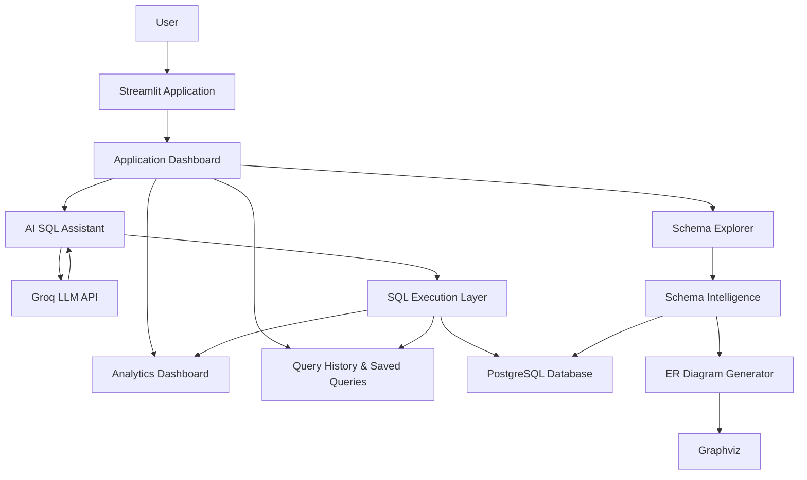

# 🧠 SQLGenPro
### AI-Powered Database Intelligence Platform

**Transform natural-language questions into SQL. Explore database structures. Turn data into meaningful insights.**

SQLGenPro is an AI-powered database intelligence platform designed to simplify the way users interact with relational databases. It combines Large Language Model capabilities with PostgreSQL database integration to help users generate SQL queries from natural-language questions, explore database schemas, visualize table relationships, and analyze query results through an interactive interface.

Built with Python and Streamlit, SQLGenPro brings essential database exploration, AI-assisted querying, and analytical capabilities together in one application.

---

## 📌 Project Overview

Working with relational databases often requires users to understand SQL syntax, database structures, table relationships, and query execution. This can create a learning curve for beginners and slow down everyday database interactions.

SQLGenPro addresses this challenge by introducing an AI-assisted workflow that connects natural-language input with database operations.

Users can interact with their PostgreSQL database, obtain AI-generated SQL queries, inspect schema information, visualize entity relationships, and explore analytical insights through a unified dashboard.

**The objective:** Make database interaction more accessible, intelligent, and efficient without losing visibility into the underlying SQL and database structure.

---

## ✨ Key Features

### 1. AI-Powered Text-to-SQL
- Convert natural-language questions into SQL queries.
- Leverage Groq-powered LLM integration for SQL generation.
- Use database schema context to support query generation.
- Review generated SQL before execution.

### 2. Intelligent Schema Explorer
- Automatically inspect PostgreSQL database metadata.
- Discover tables and their columns.
- Identify primary keys, foreign keys, unique constraints, and column types.
- Display database relationships.
- Generate AI-ready schema context for natural-language-to-SQL workflows.

### 3. Automatic ER Diagram Generation
- Generate Entity Relationship Diagrams from database metadata.
- Visualize relationships between database tables.
- Identify foreign-key connections.
- Render database structures using Graphviz.

### 4. Interactive Analytics Dashboard
- Explore database information through visual analytics.
- Present query-derived insights using charts and metrics.
- Make structured data easier to interpret.

### 5. Query History
- Access previously executed queries.
- Review query activity and execution records.

### 6. Saved Queries
- Save useful SQL queries for future reference.
- Revisit and reuse stored queries.

### 7. Centralized Application Dashboard
- Access the platform's modules through a unified interface.
- Navigate between database exploration, AI-assisted querying, and analytics.
- View database-related information in one place.

---

## 🏗️ System Architecture

SQLGenPro follows a modular architecture that connects the user interface, AI processing layer, database intelligence components, and PostgreSQL database.



### Architecture Components

| Component | Responsibility |
|---|---|
| Streamlit UI | Interactive application interface |
| AI SQL Assistant | Natural-language-to-SQL workflow |
| Groq API | LLM-powered SQL generation |
| SQLAlchemy | Database connectivity and inspection |
| PostgreSQL | Relational database backend |
| Schema Intelligence | Database metadata extraction |
| Graphviz | Entity Relationship Diagram generation |
| Analytics Module | Query-result visualization |
| History & Saved Queries | Query record management |

---

## 🛠️ Technology Stack

| Category | Technologies |
|---|---|
| Programming Language | Python |
| Frontend / UI | Streamlit |
| AI Integration | Groq API, Large Language Models |
| Database | PostgreSQL |
| Database Toolkit | SQLAlchemy |
| Data Processing | Pandas |
| Diagram Generation | Graphviz |
| Development Environment | Visual Studio Code |
| Version Control | Git & GitHub |

---

## 📂 Project Structure

```text
SQLGenPro/
│
├── app/
│   ├── database/
│   ├── ui/
│   └── main.py
│
├── scripts/
│
├── tests/
│
├── .env
├── .gitignore
├── requirements.txt
└── README.md
```

*The structure above represents the main project directories. Refer to the repository for the complete implementation.*

---

## ⚙️ Installation & Setup

Follow these steps to run SQLGenPro locally.

### Prerequisites

Make sure the following are installed:

- Python 3.10 or later
- PostgreSQL
- Git
- Graphviz (system executable)
- A Groq API key

### 1. Clone the Repository

```bash
git clone YOUR_GITHUB_REPOSITORY_URL
```

```bash
cd SQLGenPro
```

### 2. Create a Virtual Environment

```bash
python -m venv .venv
```

Activate it on Windows:

```powershell
.venv\Scripts\Activate.ps1
```

### 3. Install Dependencies

```bash
pip install -r requirements.txt
```

### 4. Configure Environment Variables

Create a `.env` file in the project root and configure your credentials.

Example configuration:

```env
GROQ_API_KEY=your_groq_api_key
DATABASE_URL=your_postgresql_connection_string
```

Replace the example values with your actual credentials. Ensure the variable names match those used by your application configuration.

**Security note:** Never commit `.env` files, API keys, database passwords, or private credentials to GitHub.

### 5. Configure PostgreSQL

- Start your PostgreSQL server.
- Create a database.
- Configure the connection string.
- Ensure the database is accessible to SQLGenPro.

### 6. Configure Graphviz

Install Graphviz and ensure its `bin` directory is available in your system PATH.

Verify the installation:

```bash
dot -V
```

### 7. Run the Application

```bash
streamlit run app/main.py
```

Open the local URL provided by Streamlit in your browser.

---

## 🔄 Application Workflow

1. Connect SQLGenPro to a PostgreSQL database.
2. Inspect the database structure through Schema Explorer.
3. Extract schema information and relationships.
4. Provide a natural-language question through the AI SQL Assistant.
5. Generate SQL using the AI integration and database schema context.
6. Review and execute the generated query.
7. Explore relevant results through the analytics interface.
8. Access query records and saved queries when needed.

---

## 🎯 Design Goals

SQLGenPro was developed around the following engineering goals:

- **Accessibility:** Reduce the SQL learning barrier through natural-language interaction.
- **Modularity:** Separate application responsibilities into dedicated components.
- **Database Awareness:** Use actual database metadata to understand schema structures.
- **Visualization:** Present database relationships and analytical results clearly.
- **Practical AI Integration:** Apply LLM capabilities to a real database interaction workflow.

---

## 🚀 Future Enhancements

Potential directions for extending SQLGenPro include:

- Support for additional relational database systems.
- Advanced query optimization recommendations.
- More detailed query execution analytics.
- Role-based access and authentication.
- Deployment with managed database infrastructure.
- Expanded database performance insights.

---

## 👩‍💻 Developer

**Raga Sandhiya R.**

B.E. Computer Science and Engineering

Interested in building practical applications at the intersection of Artificial Intelligence, Machine Learning, Generative AI, and Software Development.

**Focus Areas:** AI Engineering | GenAI | Python | Database Systems | Full-Stack Development

---

## 📜 License

This project is available under the MIT License. Add a `LICENSE` file to the repository before using this declaration.

---

<p align="center">
  <b><i>SQLGenPro — Making database interaction more intelligent, intuitive, and accessible.</b></i>
</p>